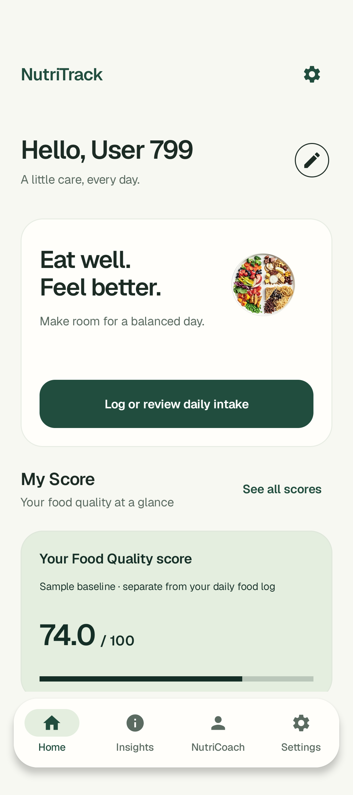
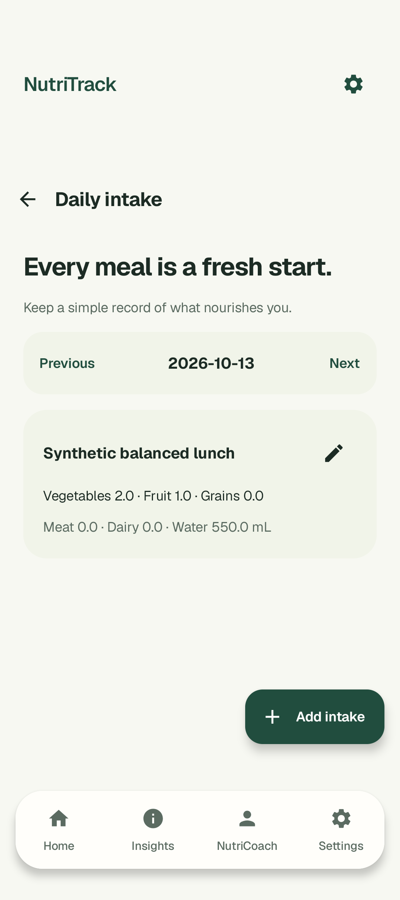
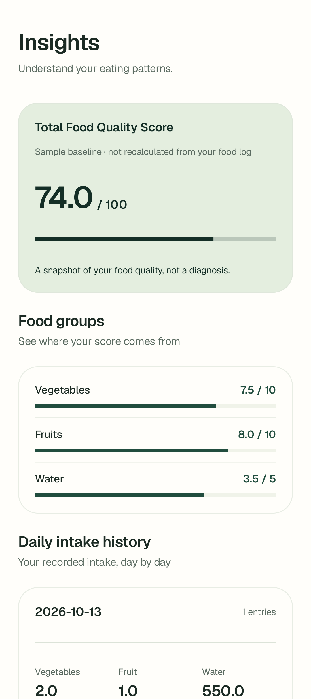
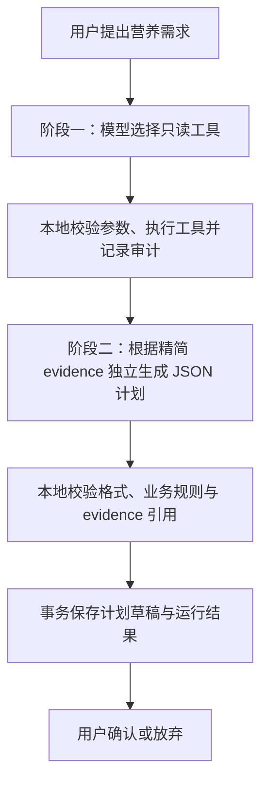

<h1 align="center">NutriTrack</h1>

<p align="center">记录每日饮食，让营养计划有据可循。</p>

<p align="center">
  <a href="https://github.com/F-yHAng/NutriTrack/actions/workflows/android.yml"></a>
  
  
  
  
</p>

<p align="center">
  <a href="#主要功能">主要功能</a> ·
  <a href="#技术设计">技术设计</a> ·
  <a href="#快速开始">快速开始</a> ·
  <a href="#项目状态与后续计划">项目状态</a>
</p>

NutriTrack 是一款使用 Kotlin 和 Jetpack Compose 构建的 Android 营养记录应用，支持饮食问卷、每日摄入记录和数据回顾，并通过可审计的 AI Agent 生成需要用户确认的营养计划草稿。

本地记录功能可独立使用，AI 功能需配置自己的 Firebase 项目。

## 界面预览

<table>
  <tr>
    <th>Home</th>
    <th>Daily Intake</th>
    <th>Insights</th>
    <th>NutriCoach</th>
  </tr>
  <tr>
    <td></td>
    <td></td>
    <td></td>
    <td></td>
  </tr>
</table>

<sub>截图使用人工演示数据；NutriCoach 展示的是测试草稿。<a href="docs/PUBLIC_RELEASE.md#截图">查看更多界面</a>。</sub>

## 主要功能

- **每日饮食记录** — 按日期新增、编辑多条摄入记录，记录食物名称、分类份数、饮水量等信息。
- **饮食习惯问卷** — 保存食物偏好、饮食习惯和作息，形成后续营养规划使用的本地画像。
- **数据回顾** — 在 Home 和 Insights 查看画像评分与每日摄入汇总，回顾已记录的饮食情况。
- **NutriCoach Agent** — 根据用户需求选择只读工具，结合画像和摄入记录生成结构化计划，并展示建议、注意事项与工具审计。
- **计划管理** — 查看、确认或放弃草稿；重新进入页面时恢复已保存状态，无需重新生成。
- **水果营养查询** — 按名称检索水果营养信息，支持加载反馈和失败重试，需要网络连接。

## 技术栈

| 方向 | 使用的技术 |
| --- | --- |
| 界面 | Jetpack Compose、Material 3、Navigation Compose |
| 状态与异步 | ViewModel、StateFlow、Kotlin Coroutines |
| 本地数据 | Room、Preferences DataStore |
| 网络 | Retrofit、OkHttp |
| AI | Firebase AI Logic、Function Calling、JSON Schema |
| 后台任务 | WorkManager |
| 测试与检查 | JUnit、Compose UI Test、Room 迁移测试、Android Lint、GitHub Actions |

## 技术设计

### 本地数据与界面状态

业务页面通过 ViewModel 暴露状态和处理事件，使用生命周期感知的方式收集 StateFlow。Room 保存账户、问卷、饮食记录与计划审计；DataStore 只保存当前用户和末次页面。项目采用单一 `:app` 模块，由 Application 手工组装依赖。

数据库保留 v5–v12 的显式迁移和 Schema；写入记录时校验用户归属与输入数据。这样可以在迭代功能时保留既有记录，并为数据变化提供可测试的路径。

### 两阶段营养规划 Agent



- **工具执行可控**：模型提出工具调用，由应用检查白名单、参数和调用预算后执行。
- **生成结果可检查**：JSON Schema 约束输出结构，本地校验进一步检查日期、数值、引用和内容规则。
- **用户决定是否采用**：生成只创建 DRAFT；确认通过幂等动作更新计划状态。
- **状态可以恢复**：运行结果和工具审计保存在 Room；页面恢复读取已有状态，不自动发起模型请求。

架构与设计取舍见 [PROJECT_CONTEXT.md](PROJECT_CONTEXT.md)。

## 快速开始

### 运行本地功能

准备 **JDK 17、Android SDK 35**，以及 **Android 15 / API 35 以上**设备或模拟器。克隆仓库后，在 Android Studio 打开项目并配置 SDK，然后运行 `app`；也可以使用命令行构建：

```sh
git clone https://github.com/F-yHAng/NutriTrack.git
cd NutriTrack
./gradlew :app:assembleDebug
```

APK 位于 `app/build/outputs/apk/debug/app-debug.apk`。

首次体验：

1. 进入 **Login → Register**，选择未注册的 Demo profile ID。
2. 点击 **Use sample number** 填入人工号码，填写虚构昵称并自行设置密码。
3. 完成问卷，进入 **Daily Intake** 新增记录，再到 **Insights** 查看汇总。

预置了 9 个样例画像，没有默认密码。所有样例都已注册时，请使用此前设置的密码登录。

### 启用 AI（可选）

在自己的 Firebase 项目中注册 Android 应用 `com.example.nutritrack`，配置 AI Logic 和 App Check，将客户端配置文件放到本地 `app/google-services.json`，然后重新构建。该文件已加入 Git 忽略规则。

未配置时，应用会提示 AI 不可用，本地记录和已有计划仍可查看。请求 AI 时，用户需求和选定的营养 evidence 会发送至 Firebase / Google；模型可用性、配额与 Release App Check 需在自己的项目中验证。

## 项目状态与后续计划

项目从教学实践持续演进，目前提供可运行的本地记录流程与两阶段 Agent 实现。HEIFA 评分来自人工样例画像，独立于每日摄入汇总，不会随新增记录自动重算。

2026-10-22 的本地验证记录包含 **164 项 JVM 测试、21 项 API 35 设备测试和 4 项发布工具测试通过**。该轮使用 Fake 外部依赖，未调用真实 AI；详细范围见 [验证记录](docs/PUBLIC_RELEASE.md#本次实际执行的验证)。

接下来优先完善：

- [ ] 计划结束日边界与退出后重登的补调度。
- [ ] 饮食记录删除与撤销、本地数据导出。
- [ ] 更多屏幕尺寸与无障碍体验。
- [ ] 自有 Firebase 环境的真实服务与 Release 验证。

## 文档与贡献

- [架构与设计决策](PROJECT_CONTEXT.md)
- [开发状态与已知问题](CURRENT_STATUS.md)
- [更多截图与验证记录](docs/PUBLIC_RELEASE.md)
- [开发与测试约定](CONTRIBUTING.md)
- [数据隐私与公开源码说明](docs/PRIVACY_REVIEW.md)

## 许可与致谢

项目级许可证尚未确定；课程衍生内容及现有插图的再发布权仍需确认。Geist 字体的 [SIL Open Font License](app/src/main/assets/licenses/geist_ofl.txt) 已随项目保留。水果查询使用 [FruityVice](https://www.fruityvice.com/) 提供的数据。

NutriTrack 提供一般营养信息，不构成医疗建议。演示请使用虚构资料。
