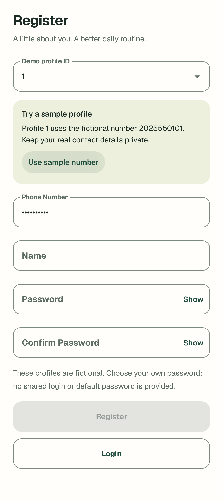
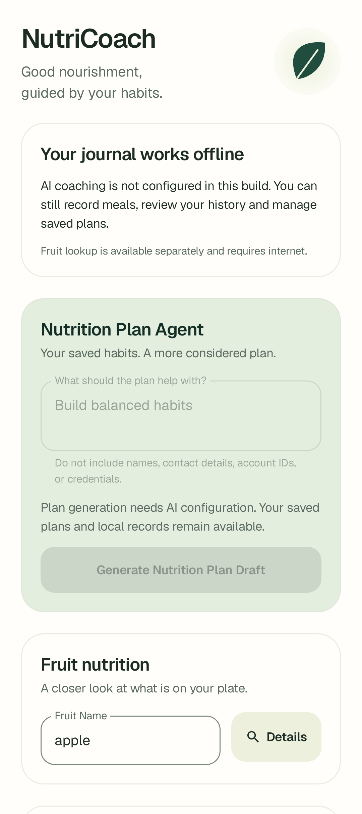
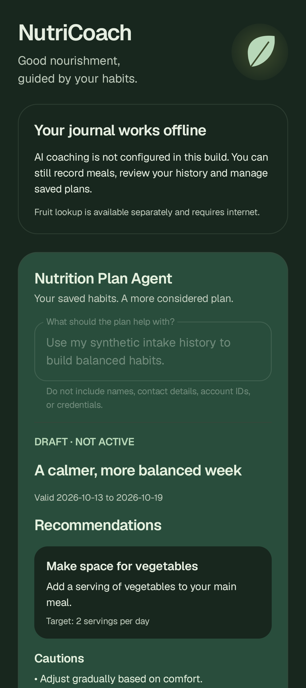

# 公开版改进与验证 · 2026-10-22

本轮针对 `NutriTrack-public-20261022` 公开副本改进。改进开始时没有 Git 历史，也没有可报告的当前分支/HEAD；原开发仓库的旧分支、stash 和历史验收只作背景。本轮改进未提交、推送或调用真实 AI；后续 GitHub 发布见本文末尾。

## 已完成

| 问题 | 现在的行为 | 代码入口 |
| --- | --- | --- |
| 首次注册需要翻 README 查人工号码 | 选定未注册样例 ID 后，显示样例说明，并提供一键填号；仍走原凭据校验，不自动注册 | `RegisterScreen.kt`、`LoginActivity.kt` |
| 无 Firebase 配置仍提示用户生成 | NutriCoach 说明可用的离线功能，禁用新计划/生成重试/激励生成；已存计划的确认与放弃保持可用 | `NutrackApplication.kt`、`HomeActivity.kt`、`NutriCoachScreen.kt` |
| 样例水果评分高就隐藏查询，还自动加载随机网络图片 | 所有样例画像都能主动查询水果；移除随机图片请求和基于假分数的“摄入最佳”结论 | `NutriCoachScreen.kt` |
| 样例评分看起来像实时饮食结果 | Home / Insights 明示 sample baseline，不随每日记录自动重算 | `HomeActivity.kt`、`InsightsScreen.kt` |
| Settings 直接访问 Repository 并持有完整账户实体 | SettingsViewModel + 只包含展示字段的 SettingsAccount + 生命周期收集；错误可重试，异常原文不进入 UI | `data/SettingsViewModel.kt`、`data/NutrackRepository.kt` |
| 设置页缺少清晰的数据说明，存在不可用的登录入口 | 分为本地账户、数据连接、演示说明；关闭 Clinician 导航入口并解释当前不可用；退出保留确认 | `SettingsScreen.kt` |
| GitHub 首页难以理解和运行 | 中文 README、真实 UI 截图、能力边界表、运行步骤、Mermaid 架构、贡献说明和 CI | `README.md`、`CONTRIBUTING.md`、`.github/workflows/android.yml` |
| 导出器可能漏掉新 CI 文件 | 明确允许指定工作流和贡献说明，增加四个发布边界回归测试 | `scripts/` |

没有修改数据库版本、历史 Schema、种子记录、Agent 两阶段协议、模型、SDK、App Check provider、签名或原有记录保存语义。AI 配置状态只说明本地初始化就绪，不承诺服务可用。

## 本次实际执行的验证

日期：2026-10-22，Asia/Kuala_Lumpur。

| 验证 | 结果与范围 |
| --- | --- |
| 全量 Debug JVM | 29 suites / **164 tests**，0 failures/errors/skipped；包含新增 6 个 Settings 状态、隔离、错误、取消和重复读取检查 |
| 构建 | `assembleDebug`、`compileReleaseKotlin`、`assembleDebugAndroidTest` 通过；不等于 Release APK/签名/安装通过 |
| 静态检查 | `lintDebug`：**0 errors/fatal，34 warnings**，没有以删除断言或放宽规则求通过 |
| 独立设备回归 | 临时 `NutriTrack_Public_20261022` AVD，API 35，1080×2424；明确选择四个测试类，共 **21 tests** 通过 |
| 设备测试类 | `VisualRefreshComposeTest`（9）、`HomeNavigationComposeTest`（6）、`CriticalUserJourneyComposeTest`（1）、`NutriCoachAgentComposeTest`（5） |
| 外部依赖 | 使用人工资料、内存/独立测试数据库、Fake Gateway；真实 AI 请求 **0**，未验证真实水果服务 |
| 发布工具 | 4 项 Python 回归通过：排除私有文件、保留 CI/文档、扫描结果不回显值、拒绝源码文件符号链接；白名单敏感模式扫描无匹配 |
| GitHub Actions | 已写入固定 commit 引用、只读权限、无 Firebase 凭据的工作流；**未在 GitHub 远端运行** |

首次尝试启动既有 `Pixel_9_API_35` 的只读实例时，安装因数据盘空间不足失败；没有卸载/清除既有应用，随后关闭该实例，使用全新临时 AVD 数据盘完成全部 21 项测试。受保护的 `Medium_Phone_API_35` 未启动、未改动。初次未找到测试 runner 是 APK 安装失败的结果，不计为测试通过。

设备回归覆盖登录→问卷→Home→记录落库、导航恢复、Fake Agent 的生成/恢复/确认，以及新注册快捷入口、未配置 AI 时的按钮状态、Settings 1.3×字号和退出确认。亮/暗主题草稿测试还验证未配置 AI 时仍可显式确认已有草稿。并非完整设备矩阵、TalkBack、所有字号或线上服务验收。

## 截图

所有图片直接来自生产 Compose 的人工测试状态，没有 AI 生成或后期改写。截图中的日期、User 799、饮食和计划均为测试夹具，不是个人资料或真实模型结果。Settings 截图使用 1.3×字体；屏幕可滚动，截图仅为当前可见区域。

<table>
<tr>
<td></td>
<td></td>
<td></td>
</tr>
<tr><td>样例注册</td><td>未配置 AI 的可用性说明</td><td>已保存草稿 · 深色</td></tr>
</table>

其他截图： [Home](screenshots/home.png)、[每日摄入](screenshots/daily-intake.png)、[Insights](screenshots/insights.png)、[Settings](screenshots/settings.png)、[草稿依据与确认](screenshots/coach-evidence-dark.png)。

## 后续优先级

1. **发布许可**：选择项目级 LICENSE 前，先核实课程衍生代码和现有插图的再发布权。此次没有替作者授予许可，也没有宣称项目已经开源许可齐全。
2. **计划生命周期正确性**：原有 R3（结束日当天与次日边界不一致）和 R4（退出、到期、重登后的旧计划补调度）仍未修复。这两项值得优先于扩展更多 AI 功能处理；需要单独补上日期和多计划回归。
3. **真实服务与发布变体**：配置自己的 Firebase 后按预算验证 Agent、失败恢复和 Release Play Integrity；当前证据仅限离线与 Debug 模拟器。
4. **更广泛的使用体验**：若希望面向普通用户发布，再规划饮食记录删除/撤销、本地数据导出、无障碍与更多屏幕尺寸。Android 15 以下兼容性、云同步均未承诺。

README 中的运行和功能边界可以作为 GitHub 作品集说明。不要把本轮验证扩写为生产稳定性、云同步、任意 Agent 自主执行或医学有效性。

## GitHub 发布 · 2026-10-23

公开仓库：[F-yHAng/NutriTrack](https://github.com/F-yHAng/NutriTrack)，默认分支 `main`，从无原 Git 历史的导出副本建立，包含 198 个白名单文件。线上 README 的四张核心界面截图已确认加载正常。

首次 CI 遇到 runner 的 `sdkmanager` 路径问题，已通过显式使用 `ANDROID_HOME/cmdline-tools/latest/bin/sdkmanager` 修复。随后 [Android checks #2](https://github.com/F-yHAng/NutriTrack/actions/runs/39812827996) 在 `da3ea39` 上通过，verify 耗时 6 分 16 秒，覆盖发布检查、JVM 测试、Debug APK 构建、Release Kotlin 和仪器源码编译、lint。后续只更新文档，不改变通过检查的代码或工作流。

此次云端检查未运行模拟器/真机测试、未调用真实 AI，也没有发布签名安装包。项目级许可证和素材权利确认仍是后续待办。
